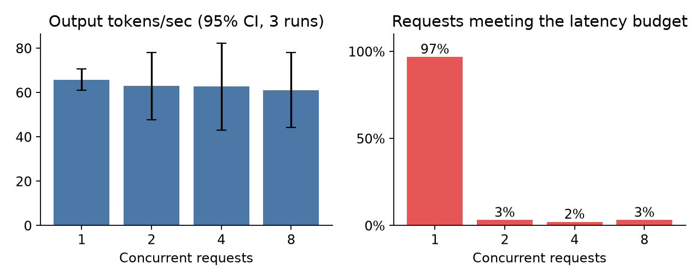

# LLM Inference Acceleration Playground

Benchmark an LLM serving endpoint, then prove the number is worth believing.

The tool drives load at any OpenAI-compatible endpoint and records TTFT, inter-token latency, TPOT, throughput, and goodput against a declared SLO.
What it adds beyond that is an audit trail: every published latency, throughput, and goodput number is recomputable from the committed per-request rows, and the same tool refuses to call a run a hardware claim when the evidence does not support one.

**Status: alpha.** There is one published real result and no GPU measurements yet, and CLI flags and result schemas may change before 1.0.

## A real result

On an Apple M3 Pro laptop, Ollama 0.34.1 serving `qwen2.5:1.5b-instruct`, 3 repetitions per point, 95% confidence intervals:

| Concurrency | Output tokens/sec | TTFT p50 | Requests meeting a 1000 ms TTFT and 15 ms TPOT budget |
| ---: | ---: | ---: | ---: |
| 1 | 65.7 [60.9, 70.5] | 287 ms | 97% |
| 2 | 62.9 [47.8, 78.1] | 1266 ms | 3% |
| 4 | 62.7 [43.1, 82.3] | 3306 ms | 2% |
| 8 | 61.1 [44.3, 77.9] | 7602 ms | 3% |



Throughput is flat, so a report that only published tokens per second would have shown four nearly identical numbers.
Goodput shows what actually happened: this server admits one request at a time, so concurrency buys queueing, and three of the four configurations miss the latency budget for almost every request.

In the same study a shared 293-word prompt prefix cut TTFT p50 by 6.6x, from 317 ms to 47.7 ms, while inter-token latency stayed unchanged at 10.4 ms, which is the signature of a prefill saving rather than a faster model.
Token counts agreed exactly with Ollama's own `eval_count` and `prompt_eval_count` on every cross-checked prompt, and per-token decode cost agreed to within 0.9% and 2.3%.

Full numbers, method, confounds, and limitations: [results/published/2026-09-16-ollama-apple-m3-pro/report.md](https://github.com/hskl18/llm-inference-acceleration-playground/blob/main/results/published/2026-09-16-ollama-apple-m3-pro/report.md).

This is a local Apple Silicon Ollama measurement.
It is not a vLLM result and not a GPU result, and the repository's own claim audit rejects it as hardware evidence with 15 blockers, which is the correct outcome.

## Architecture

<picture>
  <source media="(prefers-color-scheme: dark)" srcset="https://raw.githubusercontent.com/hskl18/llm-inference-acceleration-playground/main/docs/architecture-dark.svg">
  
</picture>

Every per-run latency, throughput, and goodput metric comes from the per-request rows in `raw_requests.jsonl`.
`report claim-audit` recomputes each one from those rows, blocks a summary that disagrees, and decides whether the run may stand as a hardware result.

## How this differs from the established tools

`vllm bench serve`, GuideLLM, and GenAI-Perf are better at generating load.
This one is stricter about what the resulting number is allowed to claim: it audits its own output, recomputes each run's latency, throughput, and goodput metrics from raw rows, and gates comparisons on invariants.
See the [full comparison](https://github.com/hskl18/llm-inference-acceleration-playground/blob/main/docs/comparison.md).

## Install

```bash
python3 -m pip install llm-accel
```

It needs Python 3.11 or newer.

## Quickstart

No GPU is required. The `mock://local` backend is deterministic and exercises the whole pipeline.

```bash
llm-accel doctor

llm-accel bench throughput \
  --base-url mock://local \
  --model mock-model \
  --concurrency 4 \
  --output-tokens 64 \
  --request-count 32 \
  --slo-ttft-ms 1000 \
  --slo-tpot-ms 15 \
  --repeats 3 \
  --output-dir results/runs/quickstart

llm-accel report validate --run-dir results/runs/quickstart/repeat-01
llm-accel report claim-audit --run-dir results/runs/quickstart/repeat-01
```

The claim audit exits non-zero, on purpose: a mock run is not hardware evidence, and the tool says so rather than letting the number escape.

Against a real endpoint, name the backend and the endpoint instead:

```bash
llm-accel bench throughput \
  --base-url http://localhost:8000/v1 \
  --backend vllm \
  --model MODEL_ID \
  --tokenizer MODEL_ID \
  --tokenizer-revision TOKENIZER_REVISION \
  --request-schedule open-loop \
  --request-rate-rps 20 \
  --concurrency 8 \
  --output-dir results/runs/vllm-run
```

## Documentation

- [Command reference](https://github.com/hskl18/llm-inference-acceleration-playground/blob/main/docs/cli.md)
- [Comparison with other tools](https://github.com/hskl18/llm-inference-acceleration-playground/blob/main/docs/comparison.md)
- [Feature list](https://github.com/hskl18/llm-inference-acceleration-playground/blob/main/docs/features.md)
- [Benchmark methodology](https://github.com/hskl18/llm-inference-acceleration-playground/blob/main/docs/benchmark_methodology.md)
- [Result schemas](https://github.com/hskl18/llm-inference-acceleration-playground/blob/main/docs/result_schemas.md)
- [Backend capabilities](https://github.com/hskl18/llm-inference-acceleration-playground/blob/main/docs/backend_capabilities.md)
- [vLLM integration](https://github.com/hskl18/llm-inference-acceleration-playground/blob/main/docs/vllm.md) and the [hardware benchmark runbook](https://github.com/hskl18/llm-inference-acceleration-playground/blob/main/docs/hardware_benchmark_runbook.md)
- [KV cache](https://github.com/hskl18/llm-inference-acceleration-playground/blob/main/docs/kv_cache.md), [quantization](https://github.com/hskl18/llm-inference-acceleration-playground/blob/main/docs/quantization.md), [speculative decoding](https://github.com/hskl18/llm-inference-acceleration-playground/blob/main/docs/speculative_decoding.md), [quality evaluation](https://github.com/hskl18/llm-inference-acceleration-playground/blob/main/docs/quality_eval.md)
- [Release process](https://github.com/hskl18/llm-inference-acceleration-playground/blob/main/docs/release.md) and [proposal coverage map](https://github.com/hskl18/llm-inference-acceleration-playground/blob/main/docs/proposal_implementation_audit.md)

## Development

```bash
python3 -m pip install -e ".[dev]"
python3 scripts/release_check.py --metadata-only
python3 -m ruff check .
python3 -m pytest
python3 scripts/smoke.py
```

The test suite does not require a GPU.
CI runs the tests and a package build on Python 3.14, so run the other checks locally.

See [CONTRIBUTING.md](https://github.com/hskl18/llm-inference-acceleration-playground/blob/main/CONTRIBUTING.md), [CODE_OF_CONDUCT.md](https://github.com/hskl18/llm-inference-acceleration-playground/blob/main/CODE_OF_CONDUCT.md), and [SECURITY.md](https://github.com/hskl18/llm-inference-acceleration-playground/blob/main/SECURITY.md).
[proposal.md](https://github.com/hskl18/llm-inference-acceleration-playground/blob/main/proposal.md) holds the full product proposal and roadmap.
